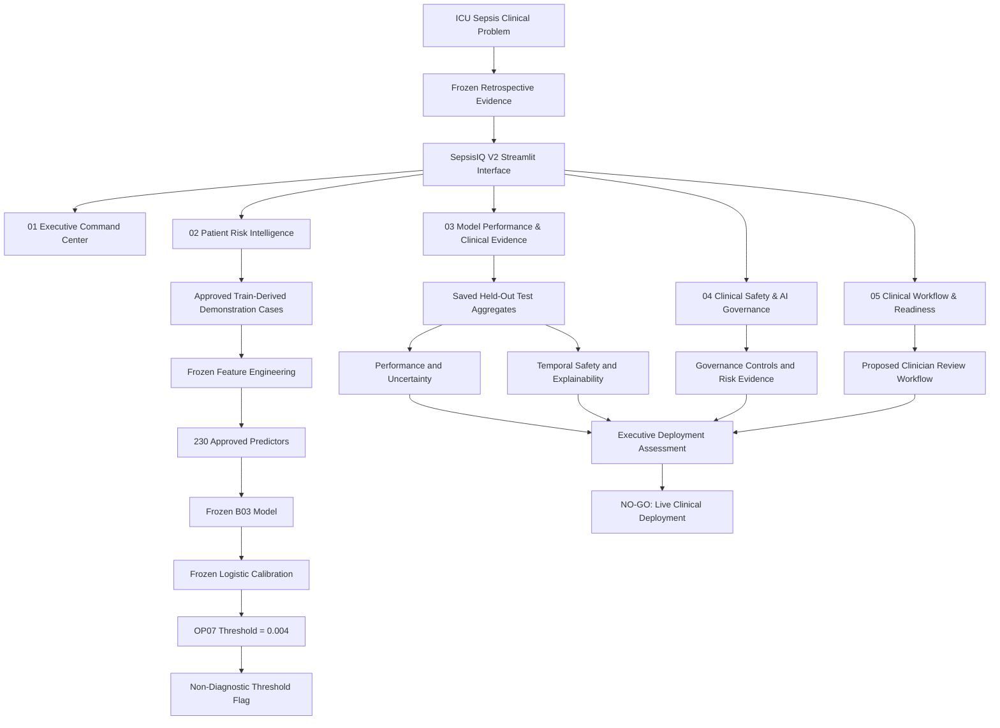
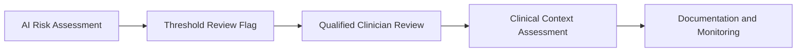

# 🫀 SepsisIQ Clinical Intelligence
## Clinical Intelligence & ICU Safety Platform

**Evidence-Driven AI · Safer Patients · Stronger Systems**

ICU Sepsis Risk Intelligence & Clinical Decision-Support Prototype

Clinical Risk Intelligence | Model Evaluation | Explainability | Governance | Patient Safety

An executive-facing, governance-aware clinical AI product demonstration for ICU sepsis risk intelligence, model evaluation, patient safety, and implementation readiness.

**Developed by Dr. Samuel Israel, MD**

---

### Technology & Product Badges


### 🚀 Launch the Application

**[▶ OPEN SEPSISIQ V2 — LIVE DASHBOARD](https://sepsisiq-v2-bfne2qdqhntja2a2pxqgxf.streamlit.app/)**

> ⚠️ **CLINICAL SAFETY NOTICE**
>
> SepsisIQ V2 is a professional portfolio demonstration, not a clinical medical device or an authorized patient-care system.
>
> It does not provide live patient monitoring, sepsis diagnoses, clinical alerts, treatment recommendations, or deployment authorization.
>
> All interactive prediction demonstrations are restricted to predefined Train-derived trajectories.

---

## 📑 Table of Contents

1. [Executive Overview](#1-executive-overview)
2. [Clinical and Business Problem](#2-clinical-and-business-problem)
3. [Product Objectives](#3-product-objectives)
4. [Platform Capabilities](#4-platform-capabilities)
5. [System Architecture](#5-system-architecture)
6. [Repository Architecture Tree](#6-repository-architecture-tree)
7. [Data and Model Specification](#7-data-and-model-specification)
8. [Clinical Model Performance](#8-clinical-model-performance)
9. [Temporal Safety Analysis](#9-temporal-safety-analysis)
10. [Explainability](#10-global-explainability)
11. [Patient Risk Demonstration](#11-patient-risk-demonstration)
12. [Clinical AI Governance](#12-clinical-ai-governance)
13. [Clinical Workflow](#13-proposed-clinical-workflow)
14. [Deployment Readiness](#14-deployment-readiness)
15. [Installation and Local Execution](#15-installation-and-local-execution)
16. [Release and Security Controls](#16-release-and-security-controls)
17. [Portfolio Competencies](#17-professional-portfolio-competencies)
18. [Author](#18-author)

---

## 1. Executive Overview

**SepsisIQ V2** is a healthcare AI product demonstration designed to connect predictive analytics with clinical safety, operational decision-making, and responsible AI governance.

The platform illustrates the lifecycle of an ICU sepsis risk-intelligence product:

**Clinical problem → Data and model evidence → Risk estimation → Safety evaluation → Human-review workflow → Governance assessment → Deployment decision**

Unlike a conventional machine-learning dashboard that focuses primarily on predictive accuracy, SepsisIQ incorporates the evidence required to assess whether a model could be responsibly considered for further clinical validation.

### Product identity

| Attribute | Description |
|---|---|
| Product | SepsisIQ V2 |
| Domain | Clinical AI / ICU Sepsis Risk Intelligence |
| AI System ID | ANIHG-AI-002 |
| Model | B03 — Histogram-Based Gradient Boosting |
| Intended future user | Qualified ICU clinicians and clinical AI governance teams |
| Current application | Non-production portfolio demonstration |
| Evidence | Frozen internal retrospective evaluation |
| Clinical authorization | Not authorized |
| Developer | Dr. Samuel Israel, MD |

---

## 2. Clinical and Business Problem

Early recognition of sepsis-related deterioration is an important challenge in intensive care.

ICU teams must interpret changing physiological observations, laboratory results, and clinical context while managing substantial information volume.

Potential clinical AI solutions introduce additional challenges:

- Missed positive observations.
- False-positive alerts and alert fatigue.
- Model behavior changing across observation-history groups.
- Dependence on local measurement and care-process patterns.
- Uncertain generalizability to other hospitals.
- Accountability for clinical review and escalation.
- Requirements for monitoring, governance, and deployment approval.

### Business opportunity

A clinically validated system could potentially support more consistent risk review and better prioritization of clinician attention.

However, such benefits remain **product hypotheses**, not demonstrated outcomes of SepsisIQ.

The current portfolio demonstrates how those hypotheses should be evaluated before an organization commits to implementation.

---

## 3. Product Objectives

SepsisIQ V2 was structured around six objectives:

1. Present ICU sepsis risk intelligence through an accessible executive-facing application.
2. Preserve the integrity of the frozen B03 prediction pipeline.
3. Demonstrate model inference without using live patient data.
4. Communicate predictive performance and clinical safety limitations transparently.
5. Integrate model governance, monitoring requirements, and readiness assessment.
6. Support evidence-based decisions about whether further validation is justified.

---

## 4. Platform Capabilities

The application is organized into five principal modules.

| Module | Description | Executive value |
|---|---|---|
| **01 — Executive Command Center** | Cohort, performance, alert burden, and deployment decision | Rapid assessment of AI product maturity |
| **02 — Patient Risk Intelligence** | Governed frozen inference using predefined demonstration trajectories | Demonstrates technical integration and threshold interpretation |
| **03 — Model Performance & Clinical Evidence** | ROC-AUC, PR-AUC, bootstrap intervals, cohort comparison, temporal safety, explainability | Evidence transparency and safety assessment |
| **04 — Clinical Safety & AI Governance** | Inventory, governance status, controls, and readiness decision | Risk accountability and traceability |
| **05 — Clinical Workflow & Implementation Readiness** | Proposed human-review workflow, alert burden, and implementation prerequisites | Operational feasibility assessment |

---

## 5. System Architecture

### 5.1 Logical platform architecture



### 5.2 Prediction-service architecture

```text
APPROVED TRAIN-DERIVED DEMONSTRATION TRAJECTORY
                         |
                         v
            Input Integrity Verification
                         |
                         v
               feature_engineering.py
                         |
                         v
             Frozen Feature Engineering
                         |
                         v
              Latest Observation Row
                         |
                         v
             Exactly 230 Predictors
                         |
                         v
                prediction_pipeline.py
                         |
                         v
                 frozen_inference.py
                         |
                         v
              Frozen B03 Estimator
                         |
                         v
           Frozen Logistic Recalibration
                         |
                         v
             Operating Threshold 0.004
                         |
                         v
               Governed Threshold Flag
                         |
                         v
                SepsisIQ Dashboard
                         |
                         v
          NON-CLINICAL DEMONSTRATION ONLY
```

**Architectural principle:** The presentation layer must not retrain the estimator, reconstruct the model, alter the approved feature specification, recalibrate outputs, or modify the frozen operating threshold.

---

## 6. Repository Architecture Tree

### 6.1 SepsisIQ V2 application package

The following represents the visible V2 dashboard package and its intended public-release structure.

```text
SepsisIQ_V2/
│
├── app.py
│   └── Main Streamlit application
│       ├── 01 Executive Command Center
│       ├── 02 Patient Risk Intelligence
│       ├── 03 Model Performance & Clinical Evidence
│       ├── 04 Clinical Safety & AI Governance
│       └── 05 Clinical Workflow & Implementation Readiness
│
├── assets/
│   └── Branding and application visual assets
│
├── .streamlit/
│   └── Streamlit application configuration
│
├── requirements.txt
│   └── Python dependencies
│
├── README.md
│   └── Product documentation
│
├── app_backup.py
│   └── Development backup (exclude from public release)
│
└── app_before_page02.py
    └── Previous development version (exclude from public release)
```

### 6.2 Original frozen model-service architecture

The dashboard's prediction integration depends on the original Sepsis_AI project services and governed artifacts.

```text
Sepsis_AI/
│
├── streamlit_app/
│   │
│   ├── app.py
│   │
│   ├── components/
│   │   ├── ui.py
│   │   ├── patient_prediction.py
│   │   ├── clinical_decision_support.py
│   │   ├── explainability_evidence.py
│   │   ├── governance_readiness.py
│   │   └── about_resources.py
│   │
│   ├── services/
│   │   ├── __init__.py
│   │   ├── feature_engineering.py
│   │   ├── frozen_inference.py
│   │   └── prediction_pipeline.py
│   │
│   ├── demo_data/
│   │   ├── demo_case_manifest.csv
│   │   ├── demo-low_trajectory.csv
│   │   └── demo-review_trajectory.csv
│   │
│   └── pages/
│       └── Reserved for additional pages
│
├── artifacts/
│   │
│   ├── phase03_features/
│   │   └── approved_feature_registry.csv
│   │
│   ├── phase04_modeling/
│   │   └── B03_frozen_fitted_estimator.pkl
│   │
│   └── phase07_streamlit/
│       ├── phase07_final_acceptance_record.json
│       ├── phase07_end_to_end_prediction_pipeline_metadata.json
│       ├── phase07_frozen_inference_service_metadata.json
│       ├── phase07_governance_integration.json
│       └── Other integrity and integration artifacts
│
└── Additional project documentation and evidence
```

**Repository note:** These are two distinct local application structures. The V2 dashboard must have a verified deployment dependency strategy before publication. The original service modules and model artifacts are not automatically included merely because the V2 application imports them locally.

The tree is an architectural representation based on the shared project structure; it is not a verified inventory of a deployed GitHub repository.

---

## 7. Data and Model Specification

### 7.1 Analytical cohort

| Dataset characteristic | Value |
|---|---:|
| Analytical patients | 40,336 |
| Analytical patient-hours | 1,527,226 |
| Positive target patient-hour rows | 2,932 |
| Positive patient-hour prevalence | 0.192% |
| Held-out Test patients | 6,051 |
| Held-out Test patient-hours | 228,452 |

**Important:** The number of positive target rows represents patient-hour observations, not the number of sepsis-positive individuals.

### 7.2 Frozen estimator

| Parameter | Frozen specification |
|---|---|
| Model identifier | B03 |
| Algorithm | Histogram-Based Gradient Boosting |
| Approved predictors | 230 |
| Calibration | Logistic recalibration |
| Calibration alpha | -0.868675893491 |
| Calibration beta | 0.858595710231 |
| Calibration epsilon | 1e-8 |
| Operating point | OP07 |
| Threshold | 0.004 |
| Clinical authorization | False |

The frozen estimator is protected by a SHA-256 integrity check.

**Model SHA-256:**

```text
d9dd6d01100bf82a0ba2ede5914b9294fe9bb87b4980c0df1584bf5edfc40a69
```

---

## 8. Clinical Model Performance

### 8.1 Held-out Test results

| Metric | Result | 95% patient-cluster bootstrap interval |
|---|---:|---:|
| ROC-AUC | 0.834478 | 0.817657–0.851561 |
| PR-AUC | 0.012340 | 0.010485–0.016619 |
| Brier score | 0.001914 | 0.001741–0.002084 |
| Sensitivity | 48.41% | 43.84–52.81% |
| Specificity | 91.77% | 90.94–92.61% |
| Positive predictive value | 1.12% | 0.99–1.27% |
| Threshold flags / 100 patient-hours | 8.31 | 7.46–9.14 |
| Patients with at least one flag | 69.00% | 67.94–70.22% |

Intervals were generated using 1,000 patient-clustered bootstrap replicates.

## 🩺 Clinical AI Performance, Safety Implications & Executive Decisions

SepsisIQ extends beyond conventional machine-learning performance reporting by translating retrospective model evidence into clinical safety findings, operational implications, product requirements, and governance decisions.

The assessment covers model discrimination, rare-event precision, sensitivity, false-positive burden, temporal instability, calibration, explainability, population coverage, and deployment readiness.

**Key findings**

| Evidence | Clinical and product implication |
|---|---|
| ROC-AUC: 0.8345 | Promising discrimination does not establish clinical utility |
| Sensitivity: 48.41% | Significant missed positive patient-hour observations |
| PPV: 1.12% | Low precision creates substantial review-burden concerns |
| Patient flag exposure: 69.00% | Alert management is a major workflow requirement |
| Temporal sensitivity: 10–12% in several intermediate-history groups | Material clinical safety limitation |
| Care-process importance: 39.14% | Potential transportability and workflow-dependence concerns |

**Executive recommendation:** NO-GO for live clinical deployment. Further progression requires independent validation, clinical safety assessment, institutional approval, and controlled prospective evaluation.

### 8.2 Clinical interpretation

The ROC-AUC indicates meaningful retrospective ranking discrimination.

However, the low PR-AUC and positive predictive value demonstrate important limitations in the context of rare positive target observations.

At the frozen operating threshold, approximately 1.12% of flagged patient-hour observations are positive target observations.

The resulting flag burden could create substantial clinician-review demands if the system were translated into a real workflow without additional safety and operational controls.

These results do not establish clinical effectiveness.

---

## 9. Temporal Safety Analysis

SepsisIQ examines how sensitivity changes across the amount of available ICU observation history.

| ICU observation history | Sensitivity |
|---|---:|
| 0 hours | 96.36% |
| 1–5 hours | 12.20% |
| 6–11 hours | 10.42% |
| 12–23 hours | 11.67% |
| 24+ hours | 60.59% |

At zero hours of observation history, the false-positive rate was approximately **74.19%**.

### Key safety finding

Performance is not stable across observation-history strata.

The model exhibits particularly low sensitivity across several intermediate-history groups.

This is a material clinical safety limitation and a reason that strong overall ROC-AUC should not be interpreted as evidence of deployment readiness.

---

## 10. Global Explainability

Global model reliance was assessed using feature-family permutation importance.

| Feature family | Relative importance |
|---|---:|
| Physiology | 52.77% |
| Care process | 39.14% |
| Context and history | 8.09% |

The importance of care-process features suggests that the model may depend substantially on patterns associated with clinical measurements, documentation, or care delivery.

### Interpretation boundaries

- Permutation importance is not a causal explanation.
- The results are global, not individual-patient attributions.
- Feature reliance does not establish clinical actionability.
- Changes in local hospital workflows could alter model behavior.

These findings support further evaluation of model transportability and robustness.

---

## 11. Patient Risk Demonstration

The interactive demonstration uses two predefined Train-derived trajectories.

### Case A — Below OP07

| Field | Value |
|---|---:|
| Calibrated model score | 0.002661 |
| Operating threshold | 0.004 |
| Threshold status | BELOW OP07 |
| Observation hour | 54 |
| Observed trajectory rows | 54 |

### Case B — At or Above OP07

| Field | Value |
|---|---:|
| Calibrated model score | 0.040922 |
| Operating threshold | 0.004 |
| Threshold status | AT OR ABOVE OP07 |
| Observation hour | 249 |
| Observed trajectory rows | 249 |

These are technical demonstration outputs, not live clinical predictions.

A threshold flag is not a sepsis diagnosis, clinical alert, or treatment recommendation.

### Demonstration safeguards

- Two fixed demonstration files only.
- Train-derived trajectories.
- Exactly 230 approved predictors.
- Frozen B03 estimator.
- Frozen calibration and OP07 threshold.
- SHA-256 integrity controls.
- No arbitrary patient input.
- No held-out Test rescoring.
- No model retraining.

---

## 12. Clinical AI Governance

SepsisIQ links technical model evidence with documented governance requirements.

### Governance components

| Domain | Status |
|---|---|
| AI system inventory | Documented |
| Frozen model evidence | Documented |
| Clinical safety and risk controls | Defined |
| Monitoring framework | Specified, not operationally validated |
| Safety-stop conditions | 8 defined |
| Readiness assessment | 19 domains |
| Safety-critical readiness domains | 18 |
| Live deployment blockers | 16 documented |
| Live hospital controls | Not established |

The governance framework supports structured review but does not replace institutional authorization.

---

## 13. Proposed Clinical Workflow



This is a **proposed workflow**, not an implemented hospital process.

### Implementation considerations

A real-world version would require:

- Local clinical ownership.
- Clear review and escalation responsibilities.
- Alert grouping and suppression rules.
- Assessment of missed events.
- Alert-fatigue and workload evaluation.
- Data-quality monitoring.
- Clinical safety monitoring.
- Change-control procedures.

---

## 14. Deployment Readiness

### Executive decision: NO-GO

**Live clinical deployment is not authorized.**

| Stage | Current position |
|---|---|
| Portfolio demonstration | Available |
| Frozen retrospective evidence | Available |
| Prospective silent validation | Conditional on institutional approval and prerequisites |
| Live clinical deployment | Not ready / not authorized |

### Required next-stage evidence

Before a hospital could consider deployment, further work would include:

1. Institutional approval and clinical ownership.
2. Independent validation in the intended clinical environment.
3. Assessment of local population and workflow differences.
4. Prospective silent-mode evaluation.
5. Clinical review and alert-burden assessment.
6. Monitoring implementation and safety testing.
7. Formal governance review and authorization.

No mortality benefit, shorter ICU stay, cost savings, or return on investment has been established.

---

## 15. Installation and Local Execution

### 15.1 Requirements

- Compatible Python environment.
- Streamlit.
- pandas and NumPy.
- Altair.
- scikit-learn.
- Required frozen inference services and approved model artifacts.

### 15.2 Clone the repository

```bash
git clone https://github.com/YOUR-USERNAME/YOUR-REPOSITORY.git
cd YOUR-REPOSITORY
```

Replace the placeholder repository URL with the actual GitHub repository.

### 15.3 Create a virtual environment

**Windows PowerShell:**

```powershell
python -m venv .venv
.\.venv\Scripts\Activate.ps1
```

### 15.4 Install dependencies

```powershell
python -m pip install -r requirements.txt
```

### 15.5 Launch SepsisIQ

```powershell
python -m streamlit run app.py --server.port 8502
```

Open:

```text
http://localhost:8502
```

If port 8502 is already occupied, use another available port.

### Deployment dependency warning

The frozen inference implementation currently references artifacts in the original local Sepsis_AI project.

A clean deployment requires explicit packaging of permitted dependencies, portable paths, and successful integration testing.

**Do not replace the frozen model, recalibrate probabilities, change OP07, or rescore the closed held-out Test dataset to resolve deployment errors.**

---

## 16. Release and Security Controls

Before making the GitHub repository public:

- [ ] Confirm `app.py` is the approved V2 entry point.
- [ ] Remove development backup files from the public release.
- [ ] Verify all required imports and dependencies.
- [ ] Confirm the frozen model SHA-256.
- [ ] Verify the approved 230-predictor feature specification.
- [ ] Verify both fixed demonstration outputs.
- [ ] Replace machine-specific absolute paths.
- [ ] Exclude secrets, credentials, and unnecessary local files.
- [ ] Review source-data and model-artifact redistribution rights.
- [ ] Ensure no identifiable patient information is included.
- [ ] Confirm non-clinical-use warnings remain visible.
- [ ] Test the deployed application from a clean environment.
- [ ] Add the verified public launch URL to this README.

---

## 17. Professional Portfolio Competencies

SepsisIQ V2 demonstrates applied capability across:

**Clinical AI & Data Science**
- Healthcare machine-learning integration.
- Model performance interpretation.
- Rare-event classification evaluation.
- Calibration and operating-threshold governance.
- Clinical explainability.

**AI Product Management**
- Clinical problem framing.
- AI product architecture.
- Executive dashboard design.
- Workflow and stakeholder considerations.
- Product maturity assessment.

**Responsible AI & Governance**
- AI system inventory.
- Model traceability.
- Clinical safety evaluation.
- Monitoring and risk-control design.
- Evidence-based deployment decisions.

**Healthcare AI Strategy**
- Clinical and business value hypotheses.
- Operational risk assessment.
- Deployment feasibility.
- Human oversight.
- Executive communication.

### Portfolio takeaway

**SepsisIQ demonstrates the distinction between building an AI prediction capability and establishing a safe, governed, clinically deployable healthcare AI product.**

---

## 18. Author

### Dr. Samuel Israel, MD

**Clinical AI | Healthcare AI Strategy | Digital Health Transformation | AI Product Management | Responsible AI Governance**

Physician and healthcare AI practitioner working at the intersection of clinical expertise, machine learning, AI product development, clinical safety, and enterprise AI governance.

**Project:** SepsisIQ V2 — Clinical Intelligence & ICU Safety Platform  
**AI System ID:** ANIHG-AI-002  
**Document:** README.md  
**Release:** V2 · October 2026

---

### Final Clinical Disclaimer

SepsisIQ is a professional portfolio demonstration based on frozen retrospective model evidence.

It is not approved for clinical deployment and must not be used for real-world patient diagnosis, monitoring, treatment, triage, or clinical decision-making.

**© 2026 Dr. Samuel Israel. Project documentation.**

## Dataset Attribution & Licensing

SepsisIQ V2 uses retrospective clinical data originating from the **PhysioNet/Computing in Cardiology Challenge 2019: Early Prediction of Sepsis from Clinical Data**.

**Dataset source:** https://physionet.org/content/challenge-2019/1.0.0/

**Dataset license:** Creative Commons Attribution 4.0 International (CC BY 4.0)

**License:** https://creativecommons.org/licenses/by/4.0/

### Demonstration Data Provenance

The application includes two controlled demonstration trajectories selected from the original training partition:

- **DEMO-LOW:** 54-hour retrospective trajectory, below the OP07 operating threshold.
- **DEMO-REVIEW:** 249-hour retrospective trajectory, at or above the OP07 operating threshold.

The original source identifiers have been replaced with demonstration-specific labels. These are **Train-derived clinical trajectories, not synthetic patient records**.

The demonstration files are included solely to illustrate frozen-model inference and research-oriented clinical AI assessment.

The dataset's original creators and PhysioNet do not endorse this application.

### Research and Clinical Safety Disclaimer

SepsisIQ V2 is a retrospective research and portfolio demonstration. It is not authorized for clinical deployment, patient diagnosis, treatment recommendations, or real-time clinical decision-making.

All performance findings require appropriate external and prospective validation before any consideration of clinical use.